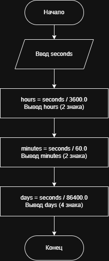

# Домашнее задание к работе 3 . Вариант 9

## Условие задачи

Написать и отладить программу пересчета заданного в секундах временного интервала в часы и минуты.

* * *

## 1. Алгоритм и блок-схема

### Алгоритм

1. Установить локаль для корректного вывода русского текста.
2. Запросить у пользователя временной интервал в секундах `seconds`.
3. Вычислить количество часов: `result = seconds / 3600.0`. Вывести результат с двумя знаками после запятой.
4. Вычислить количество минут: `result = seconds / 60.0`. Вывести результат с двумя знаками после запятой.
5. Вычислить количество суток: `result = seconds / 86400.0`. Вывести результат с четырьмя знаками после запятой.
6. Завершить программу.

### Блок-схема

### 

* * *

## 2. Реализация программы

Исходный код программы: [dzlab3.c](dzlab3.c)

* * *

## 3. Результаты работы программы

Пример работы программы:

```
Введите временной интервал в секундах:
5400
5400 секунд – это 1.50 часов
5400 секунд – это 90.00 минут
5400 секунд – это 0.0625 суток
```

Пример работы программы с другим значением:

```
Введите временной интервал в секундах:
100000
100000 секунд – это 27.78 часов
100000 секунд – это 1666.67 минут
100000 секунд – это 1.1574 суток
```

* * *

## 4. Информация о разработчике

- **ФИО:** Кочанов Кирилл Романович
- **Группа:** бОТИ-261
